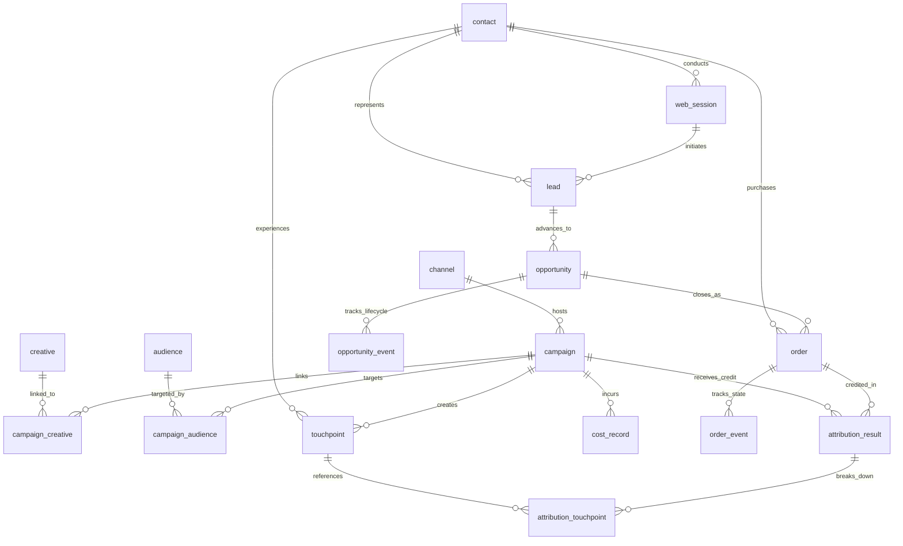

# Database Schema Specification

## 1. Overview
The Marketing Campaign Attribution & ROI Analysis System uses a relational model designed for strict referential integrity, temporal tracking, auditability, and multi-model attribution analysis.

---

## 2. Table Summary

| Table | Category | Primary Key | Key Relationships | Purpose |
| :--- | :--- | :--- | :--- | :--- |
| `channel` | Master | `channel_id` | 1:N to `campaign`, `touchpoint` | Marketing channels (paid search, social, organic, etc.) |
| `campaign` | Master | `campaign_id` | FK to `channel` | Marketing initiatives with budgets, currency, and dates |
| `creative` | Master | `creative_id` | N:M to `campaign` | Ad creatives, landing pages, banners |
| `audience` | Master | `audience_id` | N:M to `campaign` | Target audience segments |
| `contact` | Master | `contact_id` | 1:N to `touchpoint`, `web_session`, `lead`, `order` | Synthetic customer identity |
| `campaign_creative` | Bridge | `(campaign_id, creative_id, effective_from)` | FKs to `campaign`, `creative` | Effective creative assignments |
| `campaign_audience` | Bridge | `(campaign_id, audience_id, effective_from)` | FKs to `campaign`, `audience` | Effective audience targeting |
| `touchpoint` | Funnel | `touchpoint_id` | FKs to `contact`, `campaign`, `channel`, `creative` | Atomic marketing interactions (online/offline) |
| `web_session` | Funnel | `session_id` | FKs to `contact`, `campaign`, `channel` | Digital sessions; tracks evidence for identity |
| `lead` | Funnel | `lead_id` | FKs to `contact`, `web_session` | Form captures / inbound leads |
| `opportunity` | Funnel | `opportunity_id` | FK to `lead` | Sales deals with expected/closed value and status |
| `order` | Funnel | `order_id` | FKs to `opportunity`, `contact` | Economic transactions with net revenue and unique keys |
| `cost_record` | Finance | `cost_record_id` | FK to `campaign` | Actual spend records, currencies, and exchange rates |
| `attribution_result` | Analytics | `attribution_result_id` | FKs to `order`, `campaign` | Attribution shares and allocated revenue per model |
| `attribution_touchpoint` | Analytics Bridge | `(attribution_result_id, touchpoint_id)` | FKs to `attribution_result`, `touchpoint` | Traceability of touches contributing to attribution |
| `opportunity_event` | History | `opportunity_event_id` | FK to `opportunity` | Append-only opportunity state transitions |
| `order_event` | History | `order_event_id` | FK to `order` | Append-only order state transitions (paid, refunded) |
| `pipeline_run` | Audit | `run_id` | 1:N to `data_issue`, `validation_result` | Execution metadata, seed, config hash, checksums |
| `data_issue` | Audit | `issue_id` | FK to `pipeline_run` | Flagged data quality anomalies and decisions |
| `validation_result` | Audit | `validation_result_id` | FK to `pipeline_run` | Test assertions, pass/fail status, and counts |

